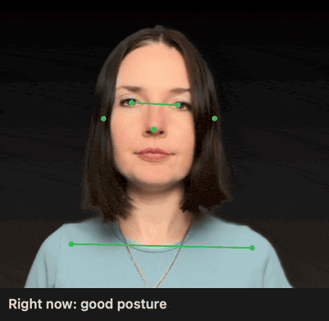
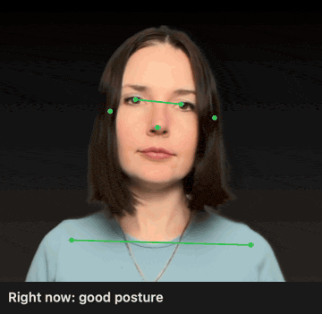
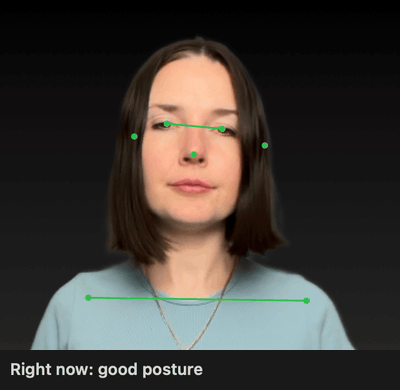

<div align="center">
  
  <h1>MantisShrimp</h1>
  <p><strong>Don't be a shrimp.</strong></p>
  <p>A quiet menu bar app that watches your posture through the Mac camera and nudges you when it slips.</p>
  <p>Everything runs on your Mac. No frames are stored or sent anywhere.</p>
</div>

## What it detects

Measured against your own calibrated baseline. Distance to the camera does not matter.

### Head position

<p>
  
  
  
</p>

1. **Tilted left**: the head leans to the left.
2. **Tilted right**: the head leans to the right.
3. **Forward**: the head pushes toward the screen, or the chin drops.

### Shoulder position

<p>
  
  
</p>

1. **Left shoulder raised**: the left shoulder sits higher than the right.
2. **Right shoulder raised**: the right shoulder sits higher than the left.

### Body position

1. **Slouching**: the head sinks toward the shoulders.
2. **Leaning in**: your whole upper body moves toward the screen.

## Install

With Homebrew, which builds the app on your Mac:

```sh
brew install veelenga/tap/mantis-shrimp
brew services start mantis-shrimp
```

The second command starts the app now and at every login, so leave the app's own **Launch at login** off. To find the app in Spotlight, link it into your Applications folder:

```sh
ln -sf "$(brew --prefix mantis-shrimp)/MantisShrimp.app" ~/Applications/
```

Or download the DMG from the [latest release](https://github.com/veelenga/mantis-shrimp/releases/latest). The app is not notarized, so macOS blocks the first launch. Open System Settings, Privacy & Security, and click **Open Anyway**.

Either way, allow camera access on first launch, then choose **Calibrate** while sitting well. The app is signed ad hoc, so macOS asks for camera access again after each update.

## Usage

### Alerts

- The menu bar figure is green when posture is good, orange when it is off, white when nobody is in frame.
- An issue counts after 10 seconds and clears 2 seconds after you fix it.
- One minute of bad posture within three minutes shows an orange banner. Click it to snooze for 5 minutes.
- After 50 minutes without a 2 minute break, a banner asks you to stand up.

### Menu options

| Item | What it does |
| --- | --- |
| Calibrate | Saves your good posture as the baseline |
| Pause / Resume | Stops and restarts monitoring |
| Sensitivity | How strict detection is |
| Alert after | 30 seconds, 1 minute (default), 2 minutes, 5 minutes, or Off; the window is three times the delay |
| Camera view | Portrait (default, sees furthest down) or Landscape (wide 4:3); each keeps its own calibration |
| Camera… | Live frame with detected points and numbers against their limits |
| Statistics… | Time in good posture today, over 7 days or 30 days |
| Launch at login | Start the app when you log in |

Escape or Cmd+W closes the Camera and Statistics windows.

### Battery

The camera runs at its lowest frame rate and posture is checked twice per second, less when nobody is there or Low Power Mode is on.
It stops while the screen is asleep or locked.

### History

One JSON line per minute in `~/Library/Application Support/MantisShrimp/history/`.

## Development

```sh
make build
make test
make run
make install   # builds, copies to ~/Applications and opens the app
```

Needs the macOS command line tools with Swift 5.10 or later. Xcode is not needed.

To release, tag a version and push the tag:

```sh
git tag v0.2.0 && git push origin v0.2.0
```

CI runs the tests, builds the DMG, publishes a GitHub release and updates the Homebrew formula in [veelenga/homebrew-tap](https://github.com/veelenga/homebrew-tap).

Released under the [MIT license](LICENSE).
