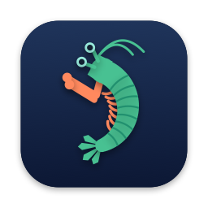
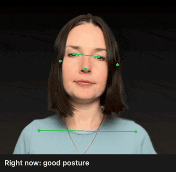

<div align="center">
  
  <h1>MantisShrimp</h1>
  <p><strong>Don't be a shrimp.</strong></p>
  <p>A quiet menu bar app that watches your posture through the Mac camera and nudges you when it slips.</p>
</div>

## Privacy

Everything runs on your Mac. No frames are stored or sent anywhere.

## What it detects

Measured against your own calibrated baseline. Distance to the camera does not matter.

| | Case | What it means | Demo |
| --- | --- | --- | --- |
| 🤷 | Shoulder raised | Left or right shoulder sits higher than the other | <!--  --> |
| 🤔 | Head tilted | Head leans to the left or right | <!--  --> |
| 🐢 | Head forward | Head pushes toward the screen, or the chin drops | <!--  --> |
| 🫠 | Slouching | Head sinks toward the shoulders | <!--  --> |
| 🔍 | Leaning in | Your whole upper body moves toward the screen | <!--  --> |

## How alerts work

- The menu bar figure is green when posture is good, orange when it is off, white when nobody is in frame.
- An issue counts after 10 seconds and clears 2 seconds after you fix it.
- One minute of bad posture within three minutes shows an orange banner. Click it to snooze for 5 minutes.
- After 50 minutes without a 2 minute break, a banner asks you to stand up.

## Install

```sh
make install
```

This builds the app, copies it to `~/Applications` and opens it. Allow camera access on first launch, then choose **Calibrate** while sitting well.

## Menu options

| Item | What it does |
| --- | --- |
| Calibrate | Saves your good posture as the baseline |
| Pause / Resume | Stops and restarts monitoring |
| Sensitivity | How strict detection is |
| Alert after | 30 seconds, 1 minute (default), 2 minutes, 5 minutes, or Off; the window is three times the delay |
| Camera view | Portrait (default, sees furthest down) or Landscape (wide 4:3); each keeps its own calibration |
| Camera… | Live frame with detected points and numbers against their limits |
| Statistics… | Time in good posture today, over 7 days or 30 days |
| Launch at login | Start the app when you log in |

Escape or Cmd+W closes the Camera and Statistics windows.

## Battery

The camera runs at its lowest frame rate and posture is checked twice per second, less when nobody is there or Low Power Mode is on.
It stops while the screen is asleep or locked.

## History

One JSON line per minute in `~/Library/Application Support/MantisShrimp/history/`.

## Development

```sh
make build
make test
make run
```

Needs the macOS command line tools with Swift 5.10 or later. Xcode is not needed.
